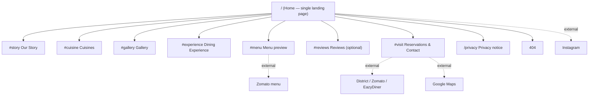

# 04 — Information Architecture

## 1. Decision: structure (DEC-002)
Options: (a) one long landing page with anchors, (b) separate pages, (c) hybrid.

**Recommendation: single landing page with anchor navigation, plus one `/privacy` route.** Reasons: small content volume; goals are quick actions (call, directions, menu, reserve); menu and booking live externally; fewer pages = less maintenance; one URL concentrates SEO signals. Re-evaluate if CMS/menu or events launch in Phase 2.

Not creating separate Story/Menu/Gallery/Dining pages: content would be thin and duplicate the landing page.

## 2. Sitemap

## 3. Route definitions
| Route | Purpose | Index? | Notes |
|-------|---------|--------|-------|
| `/` | Landing page | Yes | Canonical `https://<domain>/` (domain Unknown) |
| `/#story` … `/#visit` | In-page anchors | n/a | Not separate URLs for SEO |
| `/privacy` | Privacy notice | Yes (low priority) | Needed if analytics/forms used |
| `*` | 404 | No (`noindex`) | Branded fallback |

## 4. Navigation hierarchy
Header (sticky): Logo → Story · Cuisine · Gallery · Experience · Menu · Visit · **[Reserve]** CTA.
Mobile: hamburger with same items; Call and Reserve prominent at bottom of drawer.
Optional floating mobile action bar (Could): Call · Directions · Reserve.

## 5. Footer structure
1. Brand block: logo, one-line descriptor.
2. Contact (NAP): name, address, phone `tel:` link, hours (when supplied).
3. Quick links: anchors.
4. Reserve/Menu: provider links, Zomato menu.
5. Social: Instagram.
6. Legal: Privacy, © year.

## 6. Internal linking strategy
- Hero CTAs → `#visit` and `#menu`.
- Cuisine cards → `#menu` (menu preview) or Zomato link.
- Services cards (private dining, live music) → `#visit`.
- Footer repeats primary actions.
- Each section ends with a single relevant CTA (no more than one primary per viewport).

## 7. Page-specific metadata
| Page | Title (proposed) | Meta description (proposed) | OG | Robots |
|------|------------------|----------------------------|----|--------|
| `/` | Hestiia Restaurant — Pure Vegetarian Dining in Shyam Nagar, Kanpur | Pure vegetarian North Indian, Chinese, fast food and desserts in Shyam Nagar, Kanpur. View the menu, get directions or reserve a table. | og:image 1200×630 (asset needed), og:type `restaurant.restaurant`/`website` | index, follow |
| `/privacy` | Privacy Notice — Hestiia Restaurant | How this website handles visitor data. | default | index |
| 404 | Page not found — Hestiia Restaurant | — | — | noindex |

Titles/descriptions are **Proposed**; final wording needs client approval. Remove claims (e.g., "live music") if unconfirmed.
