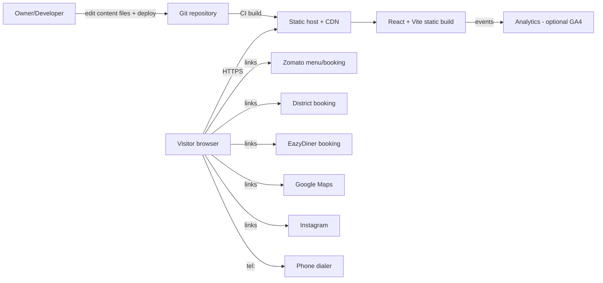

# 08 — System Architecture

## 1. Backend decision (DEC-001): Option A — Frontend-first
| Criterion | A: Frontend-first | B: CMS/backend |
|-----------|-------------------|----------------|
| Meets MVP requirements | Yes | Yes |
| Menu editing by owner | Via developer change (static file) | Yes |
| Bookings | External providers | Could add enquiries |
| Cost/complexity | Lowest | Higher (vendor, auth, security, backups) |
| Maintenance | Low | Medium |
| Security surface | Minimal | Larger |
| Time to launch | Shortest | Longer |

**Recommendation: Option A.** No database, no authentication, no custom server. Menu and booking live on external platforms already. **Revisit** (Phase 2) if the owner needs frequent self-service edits (Q-009 = yes) or wants on-site enquiries (Q-008). A headless CMS (e.g., a hosted, free-tier option) can be bolted on later because content is already modeled as typed data.

## 2. System context


## 3. Component architecture
```mermaid
flowchart TD
  App --> Layout
  Layout --> Header
  Layout --> Main
  Layout --> Footer
  Main --> Hero & Story & Cuisine & Gallery & Experience & MenuPreview & Reviews & Visit
  Gallery --> Lightbox
  Header --> MobileMenu
  App --> Content[(content/*.ts typed data)]
  App --> Animation[animation/ gsap + motion setup]
  App --> Analytics[lib/analytics track()]
  Hero & Cuisine & Gallery --> Animation
  Visit --> Analytics
```

## 4. Frontend stack (Proposed)
React 18/19 + TypeScript + Vite; CSS via CSS Modules or Tailwind (decide with design tokens — DEC-007, default: CSS variables + CSS Modules); GSAP + ScrollTrigger; Motion for React; React Router only if `/privacy` and 404 are real routes (otherwise a static `privacy.html`); Lucide icons; Vitest + React Testing Library; Playwright for e2e; ESLint/Prettier. Pin exact versions in implementation; **versions not verified here**.

## 5. Frontend module structure
```
src/
  main.tsx
  App.tsx
  components/
    layout/ Header.tsx MobileMenu.tsx Footer.tsx SkipLink.tsx
    sections/ Hero Story Cuisine Gallery Experience MenuPreview Reviews Visit
    ui/ Button.tsx ExternalLink.tsx Lightbox.tsx Tabs.tsx Icon.tsx
  content/            # typed static data (see 09)
    restaurant.ts navigation.ts cuisines.ts gallery.ts services.ts
    menu.ts reservations.ts seo.ts testimonials.ts
  animation/          # gsap registration, matchMedia helpers, hooks
  lib/                # analytics.ts, env.ts, links.ts
  styles/             # tokens.css, global.css
  pages/              # Privacy.tsx NotFound.tsx
public/               # favicons, robots.txt, sitemap.xml, og image
tests/                # unit, e2e
```

## 6. Routing
`/` main page; `/privacy`; `*` 404. Hash anchors for sections with scroll-margin for sticky header. SPA fallback configured on host. Prerendering/static HTML for `/` recommended (DEC-008: evaluate `vite-plugin-ssr`/prerender step) so crawlers and social previews get full HTML; at minimum include meta tags, H1, NAP and JSON-LD in `index.html`.

## 7. Content management
Static typed TS/JSON files in repo; each has `status: confirmed | pending`; a build-time validation script fails the build if a `pending` or `placeholder` item is flagged for production. Edits by developer PR. Phase 2: optional headless CMS.

## 8. Asset management
Source images in `/assets-src` (not shipped); build step generates responsive AVIF/WebP/JPEG at 480/768/1200/1920 widths; naming `hestiia-<subject>-<nn>.jpg`; max 200KB per gallery image, hero ≤ 300KB (targets); alt text stored in content files; rights/owner recorded in `assets-manifest`.

## 9. Integration boundaries
Only outbound links and one optional analytics script. No server-side secrets. All external URLs centralized in `content/reservations.ts` and `lib/links.ts`.

## 10. Environment configuration
| Var | Purpose | Secret? |
|-----|---------|---------|
| `VITE_SITE_URL` | Canonical/OG URL | No |
| `VITE_GA_MEASUREMENT_ID` | GA4 (optional) | No (public by design) |
| `VITE_ENABLE_ANALYTICS` | Feature flag | No |
Rule: never put private keys in `VITE_*` variables (they ship to the browser). `.env.example` committed; `.env` ignored.

## 11. Error handling
React error boundary around sections (fallback hides failing section, keeps nav/footer); image `onError` fallback; analytics wrapped in try/catch; 404 page; no blank screen when JS animation fails (content visible by default; animation adds classes).

## 12. Logging & monitoring
Console errors dev-only. Production: uptime monitor on `/`, optional lightweight error tracking (decision pending), Search Console, GA4 events, periodic external-link check.

## 13. Deployment architecture (Proposed)
Static hosting on a CDN-backed provider (e.g., Netlify/Vercel/Cloudflare Pages — choose per Q-020), Git-based CI: lint → typecheck → test → build → Lighthouse CI → deploy preview → production on approval. HTTPS enforced, HSTS, security headers (CSP, `X-Content-Type-Options`, `Referrer-Policy`, `Permissions-Policy`), long-cache hashed assets, short cache HTML. Custom domain DNS owner TBD.

## 14. Rejected alternatives
Microservices, SSR server, database, serverless functions — not justified for MVP. Serverless function allowed only if an enquiry form is approved (FR-017) to relay to email/WhatsApp securely.
