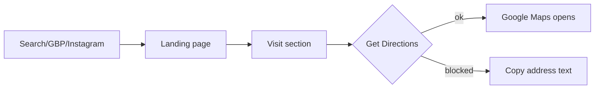
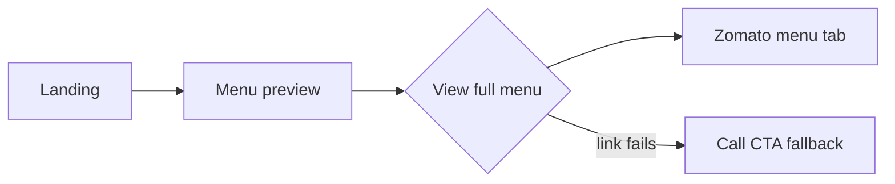
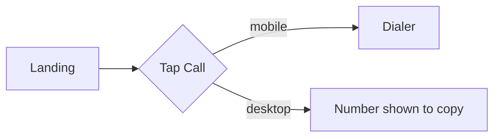
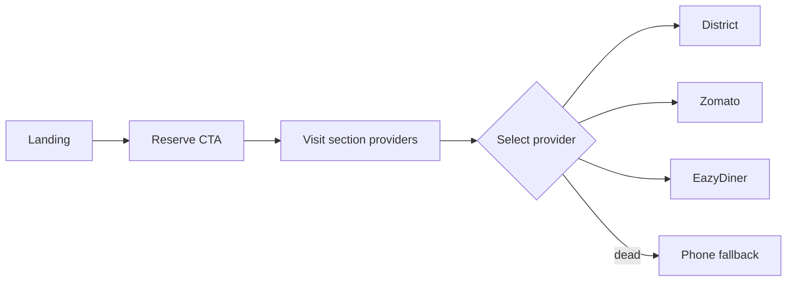
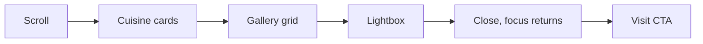
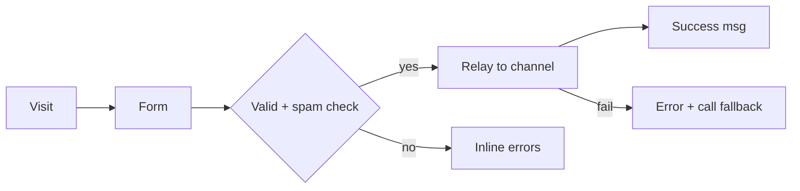

# 11 — User Journeys

Event parameter rules: no PII; params limited to `section`, `provider`, `cuisine_id`, `cta_location`, `device_type`.

## UJ-A Discover restaurant → open directions
- **Entry:** Google search / GBP / Instagram → `/`.
- **Actions:** Read hero → scroll → tap "Get Directions" (hero/footer/Visit).
- **System:** Opens Google Maps (app or web) in new tab/app.
- **Success:** Maps opens with correct restaurant search. **Failure:** Maps blocked → address text remains copyable.
- **Events:** `directions_click` {cta_location}.

## UJ-B Explore menu → external menu
- **Entry:** Hero "View Menu" or nav Menu. **Actions:** Preview → "View full menu". **System:** Opens Zomato menu in new tab.
- **Success:** Menu page loads. **Failure:** Zomato down → user sees phone CTA nearby.
- **Events:** `menu_click` {cta_location}.

## UJ-C Call restaurant
- **Entry:** Any `tel:` CTA. **Actions:** Tap phone. **System:** Dialer opens (mobile).
- **Success:** Dialer with +917880840622. **Failure:** Desktop without telephony → number visible/copyable.
- **Events:** `phone_click` {cta_location}.

## UJ-D Open reservation provider
- **Entry:** Hero "Reserve" / nav / Visit. **Actions:** Choose provider. **System:** Opens provider booking page in new tab; microcopy explains booking completes there.
- **Success:** Provider page loads (completion happens off-site, not tracked). **Failure:** Dead link → phone fallback shown.
- **Events:** `reservation_click` {provider, cta_location}.

## UJ-E Browse cuisines and gallery
- **Entry:** Scroll/nav. **Actions:** View 4 cuisines → open gallery → lightbox navigate → close → proceed to CTA.
- **System:** Reveal animations; lightbox focus managed. **Success:** User views images, returns to page position. **Failure:** Image fails → item hidden/skeleton.
- **Events:** `cuisine_section_view` {cuisine_id}, `gallery_open` {image_id}.

## UJ-F Submit enquiry (ONLY IF APPROVED — Won't for MVP)
- **Entry:** Visit section. **Actions:** Fill name, phone, date, party size, consent → submit. **System:** Validate, spam check, relay to approved channel; show "Enquiry sent. We'll contact you" (not a confirmed booking).
- **Success:** Relay OK. **Failure:** Network/validation error → inline message + phone fallback.
- **Events:** `enquiry_submit` {status: success|error} (no field values).

